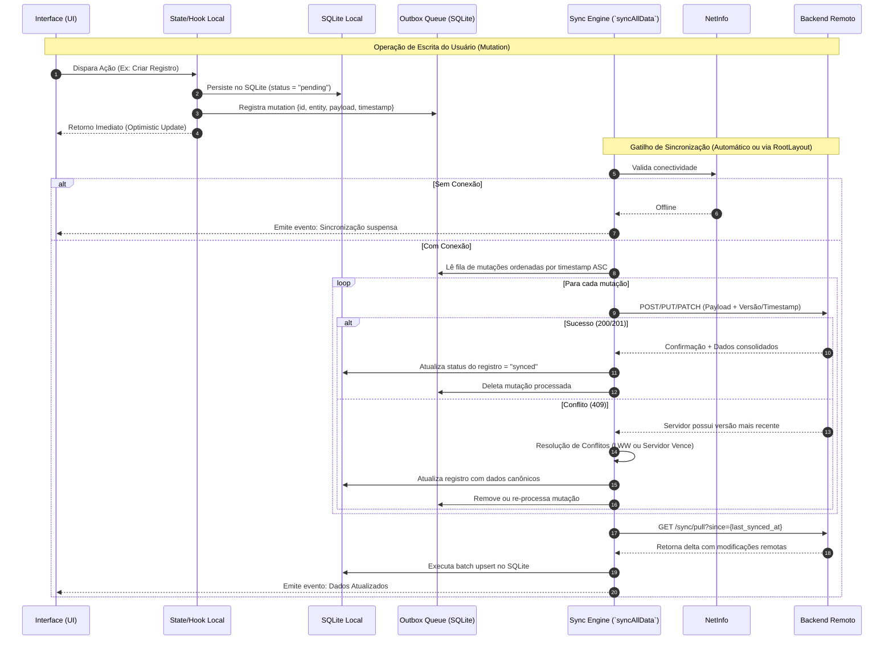
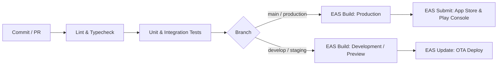

# Documento de Arquitetura de Software — Projeto Mobile

## 1. Visão Geral do Sistema e Stack Tecnológica

Sistema mobile multiplataforma (Android/iOS) desenvolvido com arquitetura **Offline-First**, orientado a domínios de negócio com sincronização bidirecional assíncrona, tolerância a falhas de rede e renderização atômica reativa.

### 1.1 Stack de Tecnologia
- **Runtime & Framework:** React Native via Expo SDK 52 (Managed Workflow / Continuous Native Generation).
- **Roteamento:** Expo Router v4 (File-system based navigation).
- **Linguagem:** TypeScript 5.3+ (Strict Mode ativado).
- **Persistência Local Primária:** `@op-engineering/op-sqlite` (Driver nativo C++ SQLite de alta performance).
- **Armazenamento Chave-Valor Rápido:** `react-native-mmkv` (Sessões, tokens, flags operacionais).
- **Gerenciamento de Estado de UI/Global:** Zustand v4+ com slices desacoplados e middleware de persistência.
- **Camada de Rede & Cache Remoto:** TanStack React Query v5 integrado com Axios (interceptors de autenticação, refresh token e métricas de telemetria).
- **Design System & Estilização:** NativeWind v4 (Tailwind CSS engine via PostCSS/Babel) + Lucide React Native (ícones).

---

## 2. Padrões Arquiteturais e Estrutura de Diretórios

A estrutura do projeto adota uma variação pragmática de **Clean Architecture** combinada com **Feature-Driven Architecture**:

```text
├── src/
│   ├── app/                      # Roteamento Expo Router (Apenas Containers/Rotas)
│   │   ├── (auth)/               # Grupo de Telas Públicas / Autenticação
│   │   ├── (tabs)/               # Telas Principais do App (Tab Navigation)
│   │   │   ├── home/
│   │   │   └── settings/
│   │   ├── _layout.tsx           # Root Layout (Hydration, Providers, Global Listeners)
│   │   └── +not-found.tsx
│   ├── assets/                   # Fontes, Imagens e SVGs estáticos
│   ├── components/               # Design System Atomic & Componentes Compartilhados
│   │   ├── ui/                   # Átomos puros: Button, Input, Modal, Typography
│   │   └── layout/               # ScreenWrapper, OfflineBanner, Header
│   ├── core/                     # Mecanismos de Infraestrutura e Libs
│   │   ├── api/                  # Axios Client, Interceptors, Base URLs
│   │   ├── database/             # SQLite Driver, Migrations, Connection Pool
│   │   ├── storage/              # Abstração MMKV
│   │   └── theme/                # Tokens de Cores, Variáveis Tailwind
│   ├── features/                 # Domínios de Negócio (Feature-First)
│   │   ├── auth/
│   │   │   ├── hooks/
│   │   │   ├── services/
│   │   │   ├── stores/
│   │   │   └── types/
│   │   └── [business-domain]/
│   │       ├── hooks/
│   │       ├── services/
│   │       ├── database/         # DAOs / Repositories específicos
│   │       └── types/
│   ├── hooks/                    # Hooks globais (useNetwork, useAppState)
│   ├── services/                 # Serviços orquestradores (ex: syncService.ts)
│   └── utils/                    # Funções utilitárias puras, formatadores, loggers
```

### Regras Estritas de Dependência
1. `src/app/` **não contém regra de negócio**. Cada rota apenas importa containers ou features e repassa parâmetros.
2. `core/database/` é agnóstico à UI e responde diretamente aos Repositories.
3. Componentes em `components/ui/` não importam instâncias de Store ou Services diretamente; operam via props controladas.

---

## 3. Arquitetura de Dados: Estratégia Offline-First & Sincronização

A sincronização de dados é centralizada e opera sob o padrão **Outbox Pattern bidirecional** com controle estrito de concorrência.



### 3.1 Mecanismo da Função `syncAllData`
- **Ponto de Invocação:** Inicializado em `src/app/_layout.tsx` (montagem pós-autenticação) e orquestrado por listeners de estado da aplicação (`AppState` transitando para `'active'`) ou reconexão via `@react-native-community/netinfo`.
- **Atomicidade:** Operações em lote no SQLite são encapsuladas em transações C++ nativas (`db.transactionAsync`) para evitar corrupção em falhas inesperadas do app durante I/O.
- **Estratégia de Resolução de Conflitos:** *Last-Write-Wins (LWW)* baseado no timestamp UTC do servidor, com fallbacks configuráveis por entidade crítica.

---

## 4. Gerenciamento de Estado e Ciclo de Vida

```text
┌────────────────────────────────────────────────────────┐
│                      Camadas de UI                     │
└───────────────────────────┬────────────────────────────┘
                            │
       ┌────────────────────┴────────────────────┐
       ▼                                         ▼
┌─────────────────────────┐           ┌────────────────────────┐
│  TanStack Query Cache   │           │     Zustand Store      │
│  (Estado de Servidor)   │           │    (Estado de UI e     │
│  - Queries Remotas      │           │   Sessão transitória)  │
│  - Invalidações via WS  │           │   - authStore          │
└──────────────┬──────────┘           │   - uiStore (Modais)   │
               │                      └──────────┬─────────────┘
               │                                 │
               ▼                                 ▼
┌─────────────────────────┐           ┌────────────────────────┐
│   SQLite / Persistence  │           │       MMKV Cache       │
│  (Dados de Negócio/     │           │  (Tokens de Auth,      │
│   Tabelas Locais)       │           │   Configurações, Chaves│
└─────────────────────────┘           └────────────────────────┘
```

1. **Estado de Servidor:** Gerenciado exclusivamente por hooks baseados em `@tanstack/react-query`. O SQLite atua como camada de fallback permanente quando a query falha ou o dispositivo está desconectado.
2. **Estado Global da Aplicação:** `zustand` com seleção estrita por selectors (`useStore(state => state.property)`) para evitar re-renderizações desnecessárias da árvore de componentes.
3. **Persistência Imediata (Fast Storage):** Sessões de autenticação, tokens JWT e estados de flags booleanas residem em `MMKV`, garantindo I/O síncrono sem overhead de serialização de strings comum no AsyncStorage.

---

## 5. Camada de Rede, Telemetria e Segurança

### 5.1 Configuração do Cliente HTTP (Axios)
- **Token Injection:** Interceptor de requisição busca o access token via `MMKV` de forma síncrona, eliminando atrasos no dispatch de requisições.
- **Refresh Flow Mutex:** Interceptor de resposta gerencia fila de retry protegida por semáforo para evitar múltiplas chamadas concorrentes de `POST /auth/refresh` quando múltiplos requests disparam HTTP 401 simultaneamente.
- **Circuit Breaker / Timeout Control:** Requisições de rede contam com timeout padrão de 10s. Falhas recorrentes acionam bypass temporário direto para a base local SQLite.

### 5.2 Segurança Operacional
- **Storage Seguro:** Chaves criptográficas e credenciais sensíveis persistidas via `expo-secure-store` no Keychain (iOS) e Keystore via EncryptedSharedPreferences (Android).
- **SSL Pinning:** Validação de certificados remotos em compilações de release (EAS) para mitigar riscos de ataques *Man-in-the-Middle (MitM)*.
- **Sanitização de Log:** Camada utilitária de logger intercepta e mascara payloads contendo PII (*Personally Identifiable Information*) e tokens antes de emitir dados para serviços de observabilidade.

---

## 6. Performance e Otimizações Críticas Mobile

### 6.1 Renderização e UI Thread
- **Estilização com NativeWind v4:** Estilos computados em tempo de compilação sem interpolação de strings em runtime, eliminando *bridge overhead* e gargalos na thread JavaScript.
- **Listas Complexas:** Substituição sistemática de `FlatList` básico por `@shopify/flash-list` para virtualização de listas de alta densidade (itens de histórico, catálogos, registros locais sincronizados), mantendo taxa estável de 60/120 FPS.
- **Lazy Loading de Rotas:** Telas aninhadas em `src/app/` carregam dependências dinamicamente, mantendo o *bundle size* inicial reduzido e acelerando o *Time-to-Interactive (TTI)*.

### 6.2 I/O de Banco de Dados Local
- **Queries Indexadas:** Criação de índices no SQLite cobrindo colunas frequentemente consultadas (`status`, `synced_at`, `user_id`).
- **Pragma Settings:**
  ```sql
  PRAGMA journal_mode = WAL;
  PRAGMA synchronous = NORMAL;
  PRAGMA cache_size = -64000;
  ```
- **Batch Processing:** Deleções, inserções ou atualizações em massa vindas de `syncAllData` ocorrem estritamente dentro de uma única transação atômica (`BEGIN TRANSACTION ... COMMIT`).

---

## 7. Estratégia de Build, CI/CD e Deployment

A aplicação utiliza infraestrutura **Continuous Native Generation (CNG)** do Expo com suporte a EAS (Expo Application Services).

### 7.1 Pipeline de Execução


### 7.2 Regras de Versionamento e Atualizações
- **Atualizações Over-The-Air (EAS Update):** Permitidas estritamente para alterações em arquivos de rotas, componentes, hooks e lógica JS/TS que não alterem bindings nativos.
- **Runtime Versioning:** Configurado como fingerprint estrito (`"runtimeVersion": { "policy": "fingerprint" }` em `app.json`). Toda adição ou upgrade de biblioteca com código nativo (Objective-C/Swift/Java/Kotlin) força a geração de novos binários (.ipa e .aab).
- **Prebuild / CNG:** Os diretórios `ios/` e `android/` são artefatos efêmeros gerados sob demanda via `npx expo prebuild` nos workers do EAS Build. Nenhuma modificação é feita diretamente no código nativo sem a intermediação de Config Plugins do Expo (`plugins` em `app.json`).