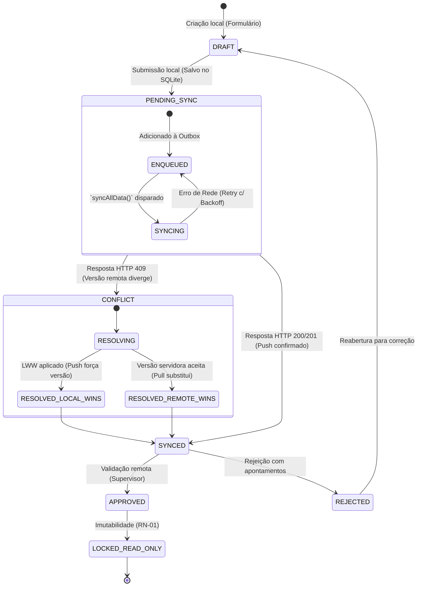

# REQUIREMENTS.md

## 1. Visão do Produto e Escopo

Aplicação mobile empresarial orientada à operação em campo com arquitetura **Offline-First**. O objetivo central é permitir a coleta de dados, execução de formulários operacionais, auditorias e gestão de atividades sem dependência de conectividade constante, garantindo persistência local atômica e reconciliação bidirecional automática com a nuvem via fila assíncrona (`Outbox`).

---

## 2. Atores e Perfis de Acesso

| Ator / Perfil | Descrição | Nível de Acesso |
|---|---|---|
| **Operador de Campo** | Usuário executor das ordens de serviço, inspeções e registros móveis. | Leitura/Escrita local das próprias tarefas e entidades associadas. |
| **Supervisor / Auditor** | Validador de dados, responsável por aprovações e reaberturas. | Leitura e moderação dos registros de sua equipe/área geográfica. |
| **Administrador** | Gestor de configurações globais, fluxos dinâmicos e usuários. | Acesso irrestrito a configurações, catálogos e regras de sync. |
| **Sistema (Sync Engine)** | Agente autônomo em background responsável pela reconciliação. | Leitura/Escrita transacional em base SQLite e API REST/GraphQL. |

---

## 3. Épicos e Histórias de Usuário

### Épico 01: Autenticação, Sessão e Segurança Local

#### US-01: Autenticação Híbrida (Online com Fallback Biométrico/Offline)
> **Como** Operador de Campo  
> **Quero** autenticar-me com credenciais na nuvem e, subsequentemente, acessar o app sem conexão via PIN/Biometria  
> **Para que** eu possa operar em áreas remotas sem bloqueio de tela.

**Critérios de Aceite (BDD):**
- **Cenário 1: Primeiro login ou expiração de refresh token persistido**
  - **Dado** que o dispositivo possui conexão de rede ativa
  - **Quando** o usuário informa e-mail/senha válidos
  - **Então** o sistema armazena o access token e refresh token no SecureStore/Keystore, inicializa o perfil local no SQLite e registra hash biométrico se aceito.
- **Cenário 2: Login em modo estritamente offline**
  - **Dado** que o dispositivo está sem conectividade e já possui credencial previamente validada
  - **Quando** o usuário fornece o PIN de 6 dígitos ou biometria local
  - **Então** o sistema libera o acesso ao banco local sem realizar chamadas de rede.

---

### Épico 02: Operação em Campo e Coleta de Dados

#### US-02: Execução e Registro de Atividades em Modo Desconectado
> **Como** Operador de Campo  
> **Quero** preencher relatórios, checklists e ordens operacionais sem travar a interface  
> **Para que** o fluxo de trabalho não seja interrompido por oscilações de 3G/4G/5G.

**Critérios de Aceite (BDD):**
- **Cenário 1: Salvamento local com enfileiramento na Outbox**
  - **Dado** que o usuário preencheu todos os campos obrigatórios de uma atividade
  - **Quando** ele aciona a ação "Salvar Atividade"
  - **Então** o registro é persistido no SQLite com status `PENDING`, inserido na fila de `outbox_mutations` em uma única transação C++ nativa e a UI exibe o estado imediatamente (Optimistic UI).
- **Cenário 2: Validação de integridade sem rede**
  - **Dado** que um campo obrigatório não foi preenchido
  - **Quando** o usuário tenta submeter o registro
  - **Então** a validação local bloqueia o salvamento e realça os campos inválidos antes de tocar no SQLite.

---

### Épico 03: Motor de Sincronização (`syncAllData`)

#### US-03: Sincronização Automática Bidirecional com Resolução de Conflito
> **Como** Sistema  
> **Quero** detectar a recuperação de conectividade ou a montagem do app e orquestrar o envio de mutações locais e a captura de deltas remotos  
> **Para que** a base local e o backend convirjam para o mesmo estado canônico.

**Critérios de Aceite (BDD):**
- **Cenário 1: Push de mutações locais pendentes**
  - **Dado** que existem registros com status `PENDING` na tabela `outbox_mutations` e a conexão retornou
  - **Quando** o método `syncAllData()` é disparado (via `_layout.tsx` ou listener do NetInfo)
  - **Então** o engine envia as mutações em ordem cronológica estrita (`timestamp ASC`) para a API.
  - **E** em caso de resposta HTTP 200/201, remove o item da `outbox_mutations` e marca o registro como `SYNCED`.
- **Cenário 2: Detecção e resolução de conflito de concorrência**
  - **Dado** que o backend retorna HTTP 409 (Conflict) informando que o registro remoto possui versão superior
  - **Quando** o motor de sincronização processa a resposta
  - **Então** aplica a regra de negócio *Last-Write-Wins (LWW)* baseada no timestamp do servidor ou preserva a versão remota, salvando log de auditoria no SQLite local.
- **Cenário 3: Pull incremental de dados**
  - **Dado** que a sincronização de subida (Push) foi concluída ou a fila estava vazia
  - **Quando** o motor requisita `GET /sync/pull?since={last_synced_at}`
  - **Então** o backend retorna o delta contendo apenas registros criados, modificados ou excluídos logicamente (*soft delete*) desde aquele marco temporal.
  - **E** o motor executa um *batch upsert* atômico dentro de `db.transactionAsync()`, atualizando o `last_synced_at` no MMKV ao término.

---

### Épico 04: Gestão de Mídia e Anexos Offline

#### US-04: Captura, Compressão e Upload Diferido de Evidências Fotográficas
> **Como** Operador de Campo  
> **Quero** anexar fotos de inspeções mesmo sem cobertura de internet  
> **Para que** as evidências visuais fiquem vinculadas à atividade e sejam enviadas em segundo plano.

**Critérios de Aceite (BDD):**
- **Cenário 1: Armazenamento local da mídia**
  - **Dado** que o operador capturou uma foto via câmera ou galeria do app
  - **Quando** o arquivo é processado
  - **Então** o sistema comprime a imagem localmente (WebP/JPEG balanceado), salva no diretório de arquivos da aplicação (`FileSystem.documentDirectory`) e registra o caminho absoluto local na tabela de anexos com flag `uploaded = false`.
- **Cenário 2: Upload resiliente em background**
  - **Dado** que há arquivos pendentes de upload e conexão Wi-Fi/4G disponível
  - **Quando** o `syncAllData` ativa o worker de upload de mídia
  - **Então** os arquivos são transmitidos via requisições *multipart/form-data* com retry exponencial em caso de timeout, sem bloquear o fluxo de sincronização textual.

---

## 4. Regras de Negócio Críticas (RN)

| Identificador | Nome da Regra | Descrição e Validação Operacional |
|---|---|---|
| **RN-01** | **Imutabilidade de Histórico Consolidado** | Registros marcados como `SYNCED` e com status de negócio `APPROVED` ou `CLOSED` tornam-se somente-leitura na interface local, impedindo mutações sem reabertura formal pelo supervisor. |
| **RN-02** | **Ordem de Dependência na Outbox** | Mutações filhas (ex: itens de checklist) jamais podem ser enviadas à API antes da confirmação de criação da entidade pai (ex: ordem de serviço). Se o pai falhar, as operações filhas são pausadas na fila. |
| **RN-03** | **Tolerância a Conexões Intermitentes** | Requisições HTTP com resposta `5xx` ou falha de timeout não descartam a transação. O sistema aplica *Exponential Backoff* com limite de 5 tentativas antes de marcar o registro como `FAILED_NEEDS_MANUAL_RETRY`. |
| **RN-04** | **Expiração de Sessão Offline** | O operador pode trabalhar offline sem autenticação remota por no máximo 72 horas consecutivas. Ultrapassado esse limite, a UI exige revalidação online para renovação das chaves de criptografia e tokens. |
| **RN-05** | **Integridade Transacional de Sync** | A execução de `syncAllData()` em `_layout.tsx` não pode travar o *Thread de Renderização (UI)* nem bloquear a navegação imediata do usuário. Ela opera como Promessa em background com feedback visual discreto (ícone/toast). |
| **RN-06** | **Tratamento de Soft Deletes** | Entidades excluídas no backend são replicadas localmente com coluna `deleted_at IS NOT NULL`. O app remove o registro das listagens operacionais mantendo o dado no SQLite até que uma rotina de *vacuum/pruning* programada limpe registros com mais de 30 dias. |

---

## 5. Requisitos Não Funcionais (RNF)

- **RNF-01 (Performance de I/O):** Tempo de escrita e leitura de formulários no banco SQLite local não deve ultrapassar **16ms** por transação típica para evitar quedas de frames (60 FPS contínuos).
- **RNF-02 (Uso de Memória e Bateria):** Rotinas de background sync não devem manter locks de CPU ativos por mais de **30 segundos** contínuos.
- **RNF-03 (Consumo de Dados):** O payload de sincronização deve trafegar exclusivamente deltas compactados via Gzip/Brotli, rejeitando payloads completos de tabelas inteiras.
- **RNF-04 (Compatibilidade de Plataforma):** Comportamento uniforme entre iOS (15+) e Android (API Level 26+), com suporte nativo a transições de lifecycle (`AppState` active/background/inactive).
- **RNF-05 (Resiliência do Banco de Dados):** Configuração do SQLite com `PRAGMA journal_mode = WAL` para viabilizar leituras concorrentes durante escritas de sincronização pesadas sem produzir erro de *database locked*.

---

## 6. Matriz de Rastreabilidade

| Requisito de Negócio | Componente/Arquivo Responsável | Mecanismo de Garantia |
|---|---|---|
| Autenticação Híbrida (US-01) | `src/features/auth/`, `expo-secure-store`, `MMKV` | Tokens cifrados e validação local de integridade |
| Escrita Offline & Outbox (US-02, RN-02) | `src/core/database/`, `op-sqlite` | Transações ACID nativas e tabela `outbox_mutations` |
| Sincronização Bidirecional (US-03, RN-03, RN-05) | `src/services/syncService.ts`, `src/app/_layout.tsx` | Chamada não bloqueante de `syncAllData()`, Pull/Push delta |
| Gestão de Mídia Diferida (US-04) | `src/features/[domain]/services/uploadWorker.ts` | Compressão prévia e fila assíncrona de uploads |
| Imutabilidade e Conflitos (RN-01, RN-06) | DAOs locais e Interceptors de Resposta da API | Regras de validação estritas antes de `INSERT/UPDATE` |---

## 7. Diagrama de Estados do Registro Operacional

O ciclo de vida de qualquer entidade editável em campo obedece à máquina de estados finita abaixo, garantindo previsibilidade entre o armazenamento local e a reconciliação remota:



---

## 8. Estrutura Canônica das Tabelas de Suporte à Sincronização

Para suportar o motor `syncAllData` e as regras de negócio descritas, o esquema relacional local (SQLite) implementa obrigatoriamente as tabelas de infraestrutura abaixo:

### 8.1 Tabela `outbox_mutations`
Gerencia a fila de operações de escrita pendentes de envio para a nuvem.

```sql
CREATE TABLE IF NOT EXISTS outbox_mutations (
    id TEXT PRIMARY KEY NOT NULL,             -- UUID v4 da mutação
    entity_name TEXT NOT NULL,                 -- Ex: 'inspections', 'work_orders'
    entity_id TEXT NOT NULL,                   -- ID da entidade modificada
    operation TEXT NOT NULL CHECK(operation IN ('INSERT', 'UPDATE', 'DELETE')),
    payload TEXT NOT NULL,                     -- JSON serializado com os campos alterados
    created_at INTEGER NOT NULL,               -- Timestamp UTC da criação local (Epoch ms)
    attempts INTEGER DEFAULT 0,                -- Contador de tentativas de retry
    last_error TEXT,                           -- Mensagem descritiva da última falha (se houver)
    status TEXT DEFAULT 'PENDING' CHECK(status IN ('PENDING', 'PROCESSING', 'FAILED'))
);

CREATE INDEX IF NOT EXISTS idx_outbox_status_created 
ON outbox_mutations (status, created_at ASC);
```

### 8.2 Tabela `sync_metadata`
Mantém o rastreamento temporal (*cursors*) de sincronização incremental para evitar downloads redundantes.

```sql
CREATE TABLE IF NOT EXISTS sync_metadata (
    entity_name TEXT PRIMARY KEY NOT NULL,     -- Nome do domínio/entidade
    last_synced_at INTEGER NOT NULL,           -- Timestamp UTC do último Pull bem-sucedido
    client_version TEXT NOT NULL               -- Versão do app para controle de compatibilidade
);
```

---

## 9. Tratamento de Exceções e Resolução de Borda

### 9.1 Bateria Crítica (< 15%)
- Se o dispositivo atingir nível crítico de bateria sem estar conectado à alimentação, o agendador de sincronização suspende o envio de arquivos de mídia volumosos (US-04), mantendo ativo apenas o tráfego textual leve (JSON via `outbox_mutations`).

### 9.2 Alteração de Estrutura de Banco de Dados Local (Migrations)
- A atualização do schema SQLite local ocorre de forma sequencial na inicialização do aplicativo em `src/core/database/migrator.ts`.
- Mutações que estejam presas na `outbox_mutations` antes da migração recebem um transformador de payload (se o schema da entidade tiver mudado) antes que a execução da versão mais recente seja permitida, garantindo que nenhum dado de campo seja descartado por incompatibilidade de versão.### 9.3 Esgotamento de Armazenamento em Disco (Disk Space Exhaustion)
- O aplicativo verifica periodicamente o espaço livre disponível no dispositivo via `FileSystem.getFreeDiskStorageAsync()`.
- **Limite Crítico (< 100 MB livres):** O app entra em modo de proteção contra corrupção do SQLite:
  1. Bloqueia a captura de novas mídias e fotos em alta resolução.
  2. Executa rotina de purga preventiva de caches efêmeros (imagens em cache HTTP do TanStack Query / FastImage).
  3. Exibe banner de alerta persistente na UI orientando a sincronização imediata e limpeza de espaço pelo sistema operacional.

### 9.4 Token Expirado Durante Execução Longa de `syncAllData`
- Se o `syncAllData` estiver processando um lote volumoso de mutações e o backend retornar HTTP 401:
  1. A fila de processamento pausa imediatamente no item corrente.
  2. O interceptor do Axios dispara a renovação atômica do token via `POST /auth/refresh` com bloqueio por semáforo (Mutex).
  3. Se o refresh for bem-sucedido, a requisição que falhou é reenviada e a fila continua do ponto onde parou sem reprocessar mutações já confirmadas.
  4. Se o refresh falhar (sessão revogada remotamente), o estado da Outbox é preservado no SQLite, o usuário é redirecionado para a tela de login/reautenticação, e nenhuma mutação pendente é descartada.

---

## 10. Governança e Métricas de Qualidade (DoR / DoD)

### 10.1 Definition of Ready (DoR)
Para que uma História de Usuário (US) ou Requisito de Negócio (RN) seja liberado para desenvolvimento, deve cumprir estritamente:
- [ ] Cenários de aceite mapeados no formato BDD (Dado / Quando / Então) cobrindo os caminhos **Online**, **Offline** e **Transição (Flapping Network)**.
- [ ] Definição explícita de impacto nas tabelas SQLite locais e se a entidade demanda entrada na `outbox_mutations`.
- [ ] Especificação do comportamento visual de Optimistic UI e mensagens de erro amigáveis ao operador.
- [ ] Contratos de API (OpenAPI / Swagger / Schemas TypeScript) consolidados entre mobile e backend.

### 10.2 Definition of Done (DoD)
Para que uma funcionalidade seja considerada pronta para release:
- [ ] **Typecheck e Linting:** `npx tsc --noEmit` e `npx expo lint` executados com **zero erros** e zero warnings impeditivos.
- [ ] **Testes de Integração de Banco:** Operações de CRUD validadas contra o SQLite com concorrência e rollback em caso de falha intencional.
- [ ] **Simulação de Modo Offline:** Testado com sucesso emulador/dispositivo físico com Wi-Fi/Dados desativados: criação de registros, persistência, fechamento do app (kill process), reabertura e sincronização posterior após religar a rede.
- [ ] **Sem Bloqueio de UI Thread:** Nenhuma operação síncrona pesada (JSON parsing massivo ou loops C++ no SQLite) mantendo a thread JS travada por mais de 1 frame (16.6ms).
- [ ] **Auditoria de EAS Build:** Binários gerados com sucesso via `eas build` sem dependências nativas manuais fora do fluxo CNG (`app.json` config plugins).